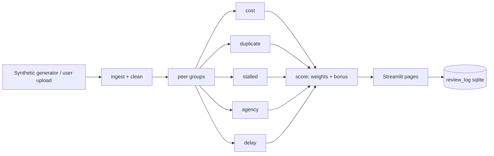

# MPLADS-Lens

Explainable outlier detection for MPLAD Scheme works data. Built for Smart India Hackathon **SIH26102 (MoSPI)**.

> **Outliers for review, not findings of fraud.** There are no confirmed labels. Every flag is a statistical prompt with a plain-language reason and the evidence behind it. Costs vary legitimately with terrain, remoteness, materials and revised scope.

## What it does
Five detectors run on works data: **cost outlier**, **near-duplicate**, **stalled work**, **agency/district pattern** and **process delay**. Their scores are combined (weights editable live), shown with severity chips, and each work has a detail page with its evidence and a "mark as reviewed" log.

The public MPLADS portal publishes only aggregate totals and per-member limits, not work-level records. The demo therefore runs on **synthetic data** (about 20,000 works, 4 states, 40 districts, fixed seed) shaped like the e-SAKSHI schema, with labelled anomalies planted for validation. Real extracts can be loaded on the Data page.

## Quick start
```bash
pip install -r requirements.txt
streamlit run app.py
```
Synthetic data is generated on first run if missing. Tests: `python -m pytest -q`.

## Pages
Overview · Flagged Works (filters, CSV export, click a row for evidence) · Work Detail · Agencies and Districts · Data (upload with column mapping, regenerate, rerun pipeline) · Method and Limits (live recall/precision vs planted anomalies) · Public Benchmarks (portal totals, no names).

## Using real data
1. Open **Data**, upload a CSV or Excel file.
2. Map your columns to the canonical schema (guesses are pre-filled; or upload a YAML like `config/column_map.example.yaml`).
3. Choose the amount unit (rupees, lakh, crore) and the as-of date. Indian number formats (`12,34,567`) and `dd-mm-yyyy` dates are parsed; dropped rows are reported with reasons.
4. Required: work category, state, district, sanctioned amount, status. More columns means more detectors can fire.

With user data, the anonymised view can be switched off in the sidebar. Free-text names inside descriptions are not anonymised.

## Architecture


## Config reference (`config/config.yaml`)
`as_of`, `flag_threshold` (40), `severity` (High 70, Medium 40), `weights`, `multi_detector_bonus`, and per-detector thresholds: `cost.z_threshold` (3.5), `cost.min_peer_size` (8), `duplicate.cosine_min/fuzz_min/window_days`, `stalled.min_sanction_age_days` (730) and `min_no_progress_days` (365), `agency.contamination`, `delay.sanction_delay_days` (75, **a placeholder: verify against the current MPLADS Guidelines**).

**Scoring note.** Weights are divided by the largest weight before summing, so the heaviest detector alone can reach 100 (a plain weighted sum would cap a single detector at 30).

## Deployment
**Streamlit Community Cloud:** push this folder to GitHub (app at the repo root, `requirements.txt` present, sample data in `data/processed/` is about 2 MB) → share.streamlit.io → New app → pick the repo, branch and `app.py` → Deploy. Python 3.11 is fine.
**Docker:** `docker build -t mplads-lens . && docker run -p 8501:8501 mplads-lens`.

## Ethics note
Anonymised by default (stable hash labels such as Constituency C-017). No names of members or constituencies are stored in the code. Synthetic data is always badged as such. Use flags to prioritise human review, never as conclusions about people or agencies.

## Known limits
Release dates are not in the schema. Public data is aggregate only. Delay thresholds need verification. Screenshots are not included in `docs/screenshots/` yet.
